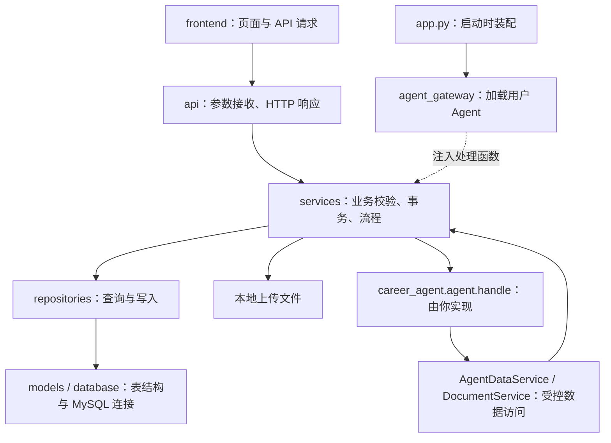

# 后端三层架构

后端使用 FastAPI、同步 SQLAlchemy 和 MySQL，按职责划分三层，采用普通类和函数。2026-11-04 的三入口工作台调整了资料确认及报告字段，当前接口以 `docs/agent-interface.md` 为准；数据库表结构及历史报告仍保留。不增加通用基类、插件系统或额外依赖。

## 调用关系

## 文件职责

| 位置 | 职责 |
| --- | --- |
| `backend/app.py` | 创建应用和服务对象、注册路由、管理关闭流程、提供静态页面 |
| `backend/api/` | 按候选人、资料、岗位、题库/记忆、报告、运行及系统拆分路由；依赖注入、异常响应和请求大小限制 |
| `backend/services/` | 对应业务服务；校验确认状态与修订号，协调数据库事务、文件和 Agent 运行 |
| `backend/repositories/` | 接收当前事务的 Session，执行 SQL/ORM 操作；不决定业务规则，不自行提交事务 |
| `backend/models.py` | SQLAlchemy 表模型，沿用现有表名和字段 |
| `backend/database.py` | 连接池、Session 工厂和数据库初始化 |
| `backend/schemas.py` | 请求资料的 Pydantic 结构与字段校验 |
| `backend/contracts.py` | Agent 命令、响应、人工输入和结果结构 |
| `backend/config.py`、`backend/exceptions.py` | 环境配置和可向调用方说明的应用异常 |
| `backend/agent_gateway.py`、`backend/demo.py` | 真实 Agent 加载入口与固定演示样例 |

## 事务与生命周期

- 每次服务操作创建自己的 Session；写操作使用 `session_factory.begin()`，成功提交，异常回滚。应用级服务只保存 Session 工厂，不共享具体 Session。
- 画像、条件和岗位的修订检查与更新在同一事务中进行，检查前锁定相应记录。新增来源合并也递增岗位修订号。
- 上传文件在保存元数据失败时删除新文件。报告只保存经过契约校验的结果和当次输入快照。
- Agent 运行仍只在内存中保存；关闭应用时先取消后台运行，再释放连接池。不会增加数据库迁移、检查点恢复或 Agent 算法。

## 从哪里读代码

三入口工作台新增 `GET/PUT /api/candidate`，将画像与条件在一个事务里确认。`services/material_validation.py` 集中检查正式入库的个人必填项和岗位盲区；界面在确认入口先提示缺项，服务只保留对应的必要一致性检查。字段仍存入现有 JSON 列，旧报告快照不迁移或重写。

先读 `api/jobs.py → services/job_service.py → repositories/job_repository.py → models.py`，这是最完整的普通业务链路。再读资料上传和 `services/run_service.py`，理解文件清理、人工确认及报告保存。

例如保存岗位：`api/jobs.py` 接收 `JobData`；`JobService.save()` 校验数据、检查来源和修订号，开启事务；`JobRepository` 在这个事务里读写岗位及来源；异常由接口层转换为 JSON。需要调整岗位规则时改服务，需要调整 SQL 查询时改仓库。

Agent 入口仍是 `career_agent.agent.handle(command, services, emit)`。`services.repository` 的既有方法由 `AgentDataService` 转交给业务服务，`services.files.resolve(document_id)` 由 `DocumentService` 提供。名称保留是为了让现有接入文档和学习路线连续；实际 SQL 只存在于数据访问层和数据库初始化中。

注释重点解释事务边界、版本冲突、文件补偿清理、确认只执行一次及日志脱敏；不逐行翻译显而易见的赋值语句。

路由拆分使用 FastAPI 的 [APIRouter](https://fastapi.tiangolo.com/reference/apirouter/) 和依赖注入。
